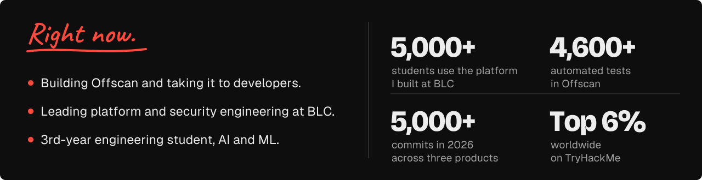
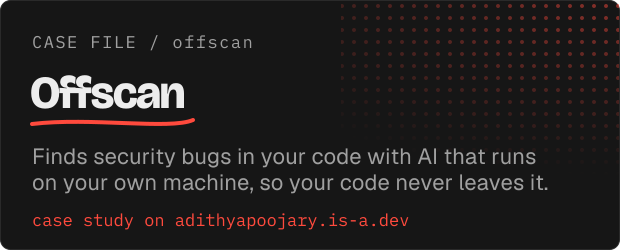
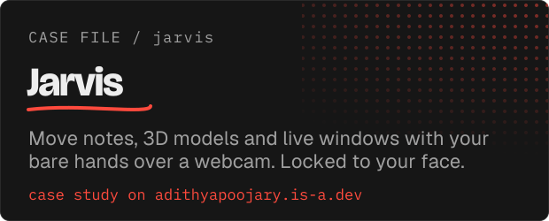
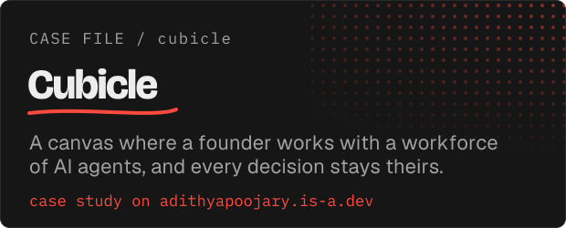
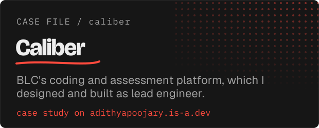
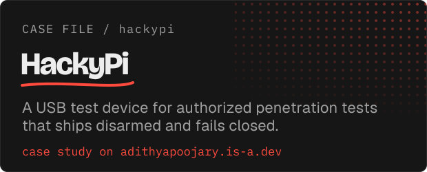
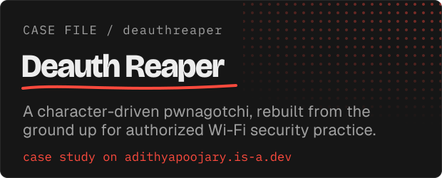

<!-- 61646974687961706f6f6a6172792e69732d612e6465762f3132 -->
<a href="https://adithyapoojary.is-a.dev"><picture><source media="(prefers-color-scheme: light)" srcset="assets/header-light.svg"></picture></a>

<p><a href="https://adithyapoojary.is-a.dev"><picture><source media="(prefers-color-scheme: light)" srcset="assets/link-site-light.svg"></picture></a>&nbsp;&nbsp;&nbsp;<a href="https://www.linkedin.com/in/adithyapoojary/"><picture><source media="(prefers-color-scheme: light)" srcset="assets/link-linkedin-light.svg"></picture></a>&nbsp;&nbsp;&nbsp;<a href="https://tryhackme.com/p/nullsec0001"><picture><source media="(prefers-color-scheme: light)" srcset="assets/link-tryhackme-light.svg"></picture></a>&nbsp;&nbsp;&nbsp;<a href="mailto:thisisadithya07@gmail.com"><picture><source media="(prefers-color-scheme: light)" srcset="assets/link-email-light.svg"></picture></a></p>

<picture><source media="(prefers-color-scheme: light)" srcset="assets/now-light.svg"></picture>

<p>
<a href="https://adithyapoojary.is-a.dev/work/offscan/"><picture><source media="(prefers-color-scheme: light)" srcset="assets/case-offscan-light.svg"></picture></a>
<a href="https://adithyapoojary.is-a.dev/work/jarvis/"><picture><source media="(prefers-color-scheme: light)" srcset="assets/case-jarvis-light.svg"></picture></a>
<a href="https://adithyapoojary.is-a.dev/work/cubicle/"><picture><source media="(prefers-color-scheme: light)" srcset="assets/case-cubicle-light.svg"></picture></a>
<a href="https://adithyapoojary.is-a.dev/work/caliber/"><picture><source media="(prefers-color-scheme: light)" srcset="assets/case-caliber-light.svg"></picture></a>
<a href="https://adithyapoojary.is-a.dev/work/hackypi/"><picture><source media="(prefers-color-scheme: light)" srcset="assets/case-hackypi-light.svg"></picture></a>
<a href="https://adithyapoojary.is-a.dev/work/deauthreaper/"><picture><source media="(prefers-color-scheme: light)" srcset="assets/case-deauthreaper-light.svg"></picture></a>
</p>

<picture><source media="(prefers-color-scheme: light)" srcset="assets/scan-light.svg"></picture>

### Capture the flag

One flag is hidden in this profile. It looks like `flag{...}`. Found it? [Submit it as an issue](https://github.com/NullSecurity07/NullSecurity07/issues/new?title=flag:%20) with the title `flag: <your flag>` and the bot checks it in under a minute.

```
clue 1: the source remembers what the page forgets
```

<!-- hof:start -->
| # | Solver | Solved |
|---|---|---|
| No solvers yet. Be the first. | | |
<!-- hof:end -->

<details><summary>sudo</summary>

```
[sudo] password for visitor: ********
access granted.

you read past the cards. most people don't.
I am always up for talking security, AI, or building
something hard. thisisadithya07@gmail.com
```

</details>

<a href="mailto:thisisadithya07@gmail.com"><picture><source media="(prefers-color-scheme: light)" srcset="assets/footer-light.svg"></picture></a>
